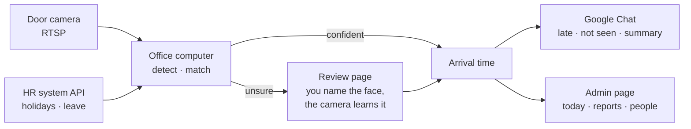

# Camera attendance

A computer in the office watches the door camera, recognises employees **locally** (no cloud), and posts to **Google Chat** who is late and who did not come. Holidays and leave come from the HR system. Windows, macOS and Linux.



## Install

Download the installer for your computer from the newest [release](https://github.com/thanhkaiba/rice-camera/releases/latest) and run it. It starts at login and opens the **Setup** page the first time (camera, hours, Google Chat, password, people). From source: `Install.bat` / `Install.command`. Everything else is in [docs/install.md](docs/install.md).

## How it decides

Times are set in Settings; defaults shown.

| | |
|---|---|
| Seen before **10:00** | On time |
| Not seen by 10:00, or seen later | Late (a late arrival is posted as it happens) |
| Not seen all morning | "Not seen" in the summary |
| On leave or holiday (HR system) | Never late or missing; holidays send nothing |
| Marked *never count as late* (the boss) | Arrival recorded, never reported |
| Camera down all day | Nobody counted as missing |
| Face unsure | Goes to **Review**; confirming records the arrival and teaches the face |

**Google Chat**, all in one thread per day: the not-seen list at 10:00 (skipped when everyone is already in), each late arrival, faces to review (one link, batched), a summary at 11:00, and warnings when the camera is down or two people's photos look alike. A separate **late message** ("Morning, coming late today: @A (10:15)…") goes out when the camera stops; its wording is in Settings. It carries one picture of the late people: each one cut out of the camera photo and put on a cheerful drawn scene (or a picture you upload in Settings) with a name tag and the time; Google Chat shows it only when the page's address is https and reachable from the internet (see [remote access](docs/install.md#remote-access)), otherwise the message links to it. @mentions need each person's Google Chat user ID (People page).

The camera only runs during the camera hours (default 08:00–11:00). Someone who arrives before 08:00 and does not pass again is counted as late, so set the start time early enough.

## Using it

- **Today:** everyone's status. Click a person to correct: move a sighting to the right person (the face is learned for them), mark it *Not them*, type an arrival time, or delete the arrival. The page says when everyone is in. **Evidence** (a link in that dialog) is a printable page for the person's day: the camera pictures with the time stamp burned in, every sighting, every correction, and whether the files are unchanged since they were taken; also as a ZIP to hand over.
- **Review:** faces the camera could not identify, grouped by person. Click one: *It's …*, pick a person, *New employee*, or *Skip*. Start without any photos this way: let the camera run a day, name each face once.
- **People:** add or import (`id,name`, optional `chat_user`, `boss`), upload 5–10 photos each, switch *never count as late*.
- **Reports:** late & absence per person and per day (CSV), recognition accuracy from your corrections, change log.
- **Camera:** live picture with labelled faces; draw the **detection area** over the walkway.
- **Settings:** hours, notifications, camera, access, HR system, recognition. Light/dark follows the system; the moon/sun button switches.

## HR system

`GET <url>?from=…&to=…` with a bearer token, returning holidays, make-up work days and leave as JSON; refreshed every 15 minutes. Format and options: [docs/hr-api.md](docs/hr-api.md). Other formats: change `parse()` in `attendance/leave_api.py`.

## Accuracy and licence

Camera placement matters most: face height, people walking towards it, light from the front, faces ≥ 80 px, no glass door behind. Then draw the detection area. Everything else (model choice, tuning with your photos, groups of people, slow computers, how wrong matches are avoided, test results on a public doorway video) is in [docs/recognition.md](docs/recognition.md).

The default `insightface` models are **non-commercial research only**; company use needs a licence from InsightFace or `backend: opencv` in `config.yaml` (free, less accurate).

## Privacy

Face photos are personal data: inform employees and get consent. Camera snapshots are deleted after 90 days, except for days on which the person was late: those are kept for a year as evidence (both in Settings); reference photos stay until deleted; deleting a person removes their face data. **Backup:** once a day everything is copied to a folder you choose (external drive, network share or cloud-synced folder); moving to another computer is `restore` from that folder, see [docs/install.md](docs/install.md#backup-and-moving-to-another-computer). Everything is in the data folder (`attendance.db`, `faces/`, `crops/`, `attendance.log`). The admin page is for the office network only; for remote access use [Tailscale](https://tailscale.com), never an open port.

## Development

```bash
pip install -r requirements-dev.txt
python -m pytest          # no models or camera needed
```

New release: push a tag (`git tag v1.2.0 && git push origin v1.2.0`), or on GitHub *Actions → Build packages → Run workflow* with the version in *release*; GitHub Actions builds and publishes the installers.
